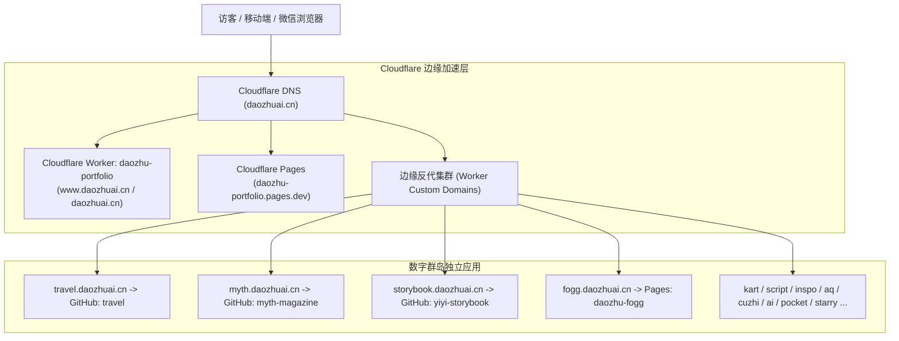

# 岛主全站生态运维交接手册（致 Cindy）

> 本手册用于指导个人官方网站（`daozhuai.cn`）及旗下「数字群岛」生态各子项目的日常维护、内容更新、新项目上线与边缘部署。

---

## 目录
1. [全站最新网址与仓库对照总表](#一全站最新网址与仓库对照总表)
2. [全站技术架构全景图](#二全站技术架构全景图)
3. [关键账号与权限凭据](#三关键账号与权限凭据)
4. [本地工程与代码仓库分布](#四本地工程与代码仓库分布)
5. [日常高频操作 SOP](#五日常高频操作-sop)
   - [SOP 1：主站内容更新（改经历、加作品、改文字）](#sop-1主站内容更新改经历加作品改文字)
   - [SOP 2：子项目代码更新（如旅行手账、神话杂志）](#sop-2子项目代码更新如旅行手账神话杂志)
   - [SOP 3：新做一个子网站并上线专属二级域名](#sop-3新做一个子网站并上线专属二级域名)
6. [必须遵守的 5 条「避坑铁律」](#六必须遵守的-5-条避坑铁律)

---

## 一、全站最新网址与仓库对照总表

### 1. 核心门户主站与交互式数字群岛
| 站点名称 | 线上正式域名 (Custom Domain) | 灾备 / 备用镜像地址 | GitHub 源码仓库 | 本地工程目录 |
| :--- | :--- | :--- | :--- | :--- |
| **岛主官方个人门户** | **[https://www.daozhuai.cn/](https://www.daozhuai.cn/)**<br>(根域名 [https://daozhuai.cn/](https://daozhuai.cn/) 自动跳转) | [https://daozhu-portfolio.pages.dev/](https://daozhu-portfolio.pages.dev/) | [daozhu1993-oss/daozhu-portfolio](https://github.com/daozhu1993-oss/daozhu-portfolio) | `daozhu-portfolio/` |
| **数字群岛（手绘乘船交互版）** | **[https://www.daozhuai.cn/islands/](https://www.daozhuai.cn/islands/)**<br>(含自由航行、登岛船票、全站浮标 `/islands/buoy.js`) | [https://daozhu-portfolio.pages.dev/islands/](https://daozhu-portfolio.pages.dev/islands/) | 同上 (`daozhu-portfolio/islands/`) | `daozhu-portfolio/islands/` |
| **实时海域与登岛足迹服务** | **[https://sea.daozhuai.cn/](https://sea.daozhuai.cn/)**<br>(`/ws` 实时同屏小船 · `/stats` 登岛统计 · `/health` 探针) | Cloudflare Durable Object (`SeaRoom` SQLite) | 本地独立归档 | `daozhu-sea-presence/` |

---

### 2. 「数字群岛」各独立子站点与应用清单
| 序号 | 站点 / 应用名称 | 线上正式域名 (带 SSL 加速) | 上游源地址 (GitHub Pages / Pages.dev) | GitHub 仓库 | 本地反代 Worker / 工程目录 |
| :---: | :--- | :--- | :--- | :--- | :--- |
| **01** | **慢游中国 · AI旅行路线定制** (最新上线) | **[https://travel.daozhuai.cn/](https://travel.daozhuai.cn/)** | `https://daozhu1993-oss.github.io/travel/` | [daozhu1993-oss/travel](https://github.com/daozhu1993-oss/travel) | `daozhu-travel-proxy/` |
| **02** | **《神话》独立数字文学杂志** (30期全集) | **[https://myth.daozhuai.cn/](https://myth.daozhuai.cn/)** | `https://daozhu1993-oss.github.io/myth-magazine/` | [daozhu1993-oss/myth-magazine](https://github.com/daozhu1993-oss/myth-magazine) | `daozhu-myth-proxy/` |
| **03** | **一一与芽芽兽 · 3D立体绘本馆** | **[https://storybook.daozhuai.cn/](https://storybook.daozhuai.cn/)** | `https://daozhu1993-oss.github.io/yiyi-storybook/` | [daozhu1993-oss/yiyi-storybook](https://github.com/daozhu1993-oss/yiyi-storybook) | `daozhu-storybook-proxy/` |
| **04** | **《福格的赌约》80天环游地球** | **[https://fogg.daozhuai.cn/](https://fogg.daozhuai.cn/)** | [https://daozhu-fogg.pages.dev/](https://daozhu-fogg.pages.dev/) (备用: `.../foggs-bet`) | [daozhu1993-oss/foggs-bet](https://github.com/daozhu1993-oss/foggs-bet) | `daozhu-fogg-proxy/` |
| **05** | **岛主 AI 日报 · Daily Curator** | **[https://dailyone.daozhuai.cn/](https://dailyone.daozhuai.cn/)** | Cloudflare Worker / Pages 聚合服务 | [daozhu1993-oss/ai-daily](https://github.com/daozhu1993-oss/ai-daily) | `ai-daily/` |
| **06** | **岛主的 AI 思考 · The Daozhu Journal** (68篇) | **[https://ai.daozhuai.cn/](https://ai.daozhuai.cn/)** | `https://daozhu1993-oss.github.io/ai-thinking/` | [daozhu1993-oss.github.io](https://github.com/daozhu1993-oss/daozhu1993-oss.github.io) | `daozhu-ai-proxy/` |
| **07** | **编剧手艺工坊 · StoryCraft** | **[https://script.daozhuai.cn/](https://script.daozhuai.cn/)** | Cloudflare Worker 边缘服务 | [daozhu1993-oss/daozhu-script](https://github.com/daozhu1993-oss/daozhu-script) | `daozhu-script/` |
| **08** | **岛主灵感工控终端 · Design & Motion** (478+) | **[https://inspo.daozhuai.cn/](https://inspo.daozhuai.cn/)** | Cloudflare Worker 边缘服务 | [daozhu1993-oss/daozhu-inspo](https://github.com/daozhu1993-oss/daozhu-inspo) | `daozhu-inspo/` |
| **09** | **《梵高的星空 · 星月孤岛》3D漫步** | **[https://starry.daozhuai.cn/](https://starry.daozhuai.cn/)** | Cloudflare Worker 边缘服务 | [daozhu1993-oss/starry-island](https://github.com/daozhu1993-oss/starry-island) | `starry-island/` |
| **10** | **《岛主卡丁车 (Daozhu Kart)》3D赛道** | **[https://kart.daozhuai.cn/](https://kart.daozhuai.cn/)** | Cloudflare Worker 边缘服务 | [daozhu1993-oss/daozhu-kart](https://github.com/daozhu1993-oss/daozhu-kart) | `daozhu-kart/` |
| **11** | **《促织 · 聊斋蟋蟀决斗》音游** | **[https://cuzhi.daozhuai.cn/](https://cuzhi.daozhuai.cn/)** | Cloudflare Worker 边缘服务 | [daozhu1993-oss/cuzhi](https://github.com/daozhu1993-oss/cuzhi) | `daozhu-cuzhi-proxy/` |
| **12** | **《阿Q正传》心理互动剧场** | **[https://aq.daozhuai.cn/](https://aq.daozhuai.cn/)** | Cloudflare Worker 边缘服务 | [daozhu1993-oss/daozhu-aq](https://github.com/daozhu1993-oss/daozhu-aq) | `daozhu-aq-proxy/` |
| **13** | **掌机游戏匣子 (Pocket Console)** | **[https://pocket.daozhuai.cn/](https://pocket.daozhuai.cn/)** | 内含单车漫游、山海经对决、GB俄罗斯方块 | [daozhu1993-oss/daozhu-pocket](https://github.com/daozhu1993-oss/daozhu-pocket) | `daozhu-pocket/` |
| **14** | **岛主小岛手记 (成长绘本 & 芽芽兽 IP 宇宙)** | **[https://me.daozhuai.cn/v2/](https://me.daozhuai.cn/v2/)** | `https://daozhu1993-oss.github.io/v2/` | [daozhu1993-oss.github.io](https://github.com/daozhu1993-oss/daozhu1993-oss.github.io) | `daozhu-island/` |

---

### 3. 知识库与开源项目
| 项目名称 | 在线访问 / 仓库地址 | 简介 |
| :--- | :--- | :--- |
| **思维模型 · 每日一模型 (230+)** | [https://daozhu1993-oss.github.io/models/index.html](https://daozhu1993-oss.github.io/models/index.html) | MECE、RIDE、金字塔、SCQA 等结构化思考单页笔记知识库 |
| **诗笺 · 诗歌排版工具** | [https://daozhu1993-oss.github.io/poem-typeset-tool/](https://daozhu1993-oss.github.io/poem-typeset-tool/) | 19 种竖排古籍、极简诗卡、杂志编辑风排版与导出工具 |
| **现实判断战略参谋** | [https://github.com/daozhu1993-oss/reality-strategy-advisor](https://github.com/daozhu1993-oss/reality-strategy-advisor) | 把商业战略方法论做成可安装的 AI 专家包（开源） |

---

### 4. 社交与商业阵地
- **小红书旅行日记**：[https://xhslink.com/m/2h5SdBrgtiq](https://xhslink.com/m/2h5SdBrgtiq)
- **官方商务合作邮箱**：`daozhu1993@gmail.com`

---

## 二、全站技术架构全景图



### 架构核心特点：
1. **统一门面，数据解耦**：
   - 个人门户主站全部内容（作品卡片、外链、经历、数据指标）都抽象在 `js/matrix-data.js` 中，**改数据不需要翻动 HTML 复杂布局**。
2. **轻量边缘反代（Worker Proxy 架构）**：
   - 子项目（如神话杂志、旅行手账）源码存放在各自独立的 GitHub 仓库并启用 GitHub Pages。
   - 通过在 Cloudflare 上部署轻量 Worker（如 `daozhu-myth-proxy`、`daozhu-travel-proxy`），绑定 `custom_domain: true`。
   - **好处**：无需在外部单独买服务器，全球节点 CDN 加速，自动申请与续签泛域名 SSL 证书，且自带穿透时间戳，GitHub 推送后秒级生效。

---

## 三、关键账号与权限凭据

Cindy 需要拥有以下平台的操作权限：

| 平台 | 账号 / 组织 | 核心作用 |
| :--- | :--- | :--- |
| **Cloudflare** | `daozhu1993@gmail.com`<br>Account ID: `63df525f13a28471e1dff3105566151b`<br>Zone ID: `4a9c11deeb79394bd062987ae70d1507` | 管理域名解析、Workers、Pages、SSL 证书与边缘缓存。本地终端只需执行 `npx wrangler login` 授权即可。 |
| **GitHub** | `daozhu1993-oss` | 存放各工程代码仓库（主站及各个子应用），CI/CD 联动 GitHub Pages。 |
| **商务合作联系** | 商务邮箱: `daozhu1993@gmail.com` | 主站弹窗与页脚关联的联系方式。 |

---

## 四、本地工程与代码仓库分布

本地根目录位于：`/Users/gx/.gemini/antigravity/scratch/`

```text
scratch/
├── daozhu-portfolio/          # 【核心】主站个人门户 & /islands/ 数字群岛源码 (www.daozhuai.cn)
├── daozhu-sea-presence/       # 【核心】实时海域、多船同屏、鸣笛、足迹簿与金帆鉴权 Worker (sea.daozhuai.cn)
├── daozhu-travel-proxy/       # 旅行手账反代 Worker (travel.daozhuai.cn，已注入浮标与 OG)
├── daozhu-myth-proxy/         # 神话杂志反代 Worker (myth.daozhuai.cn，已注入浮标与 OG)
├── daozhu-storybook-proxy/    # 3D 绘本馆反代 Worker (storybook.daozhuai.cn，已注入浮标与 OG)
├── daozhu-fogg-proxy/         # 八十天环游地球反代 Worker (fogg.daozhuai.cn，已注入浮标/OG/图标/统计)
├── daozhu-ai-proxy/           # AI思考反代 Worker (ai.daozhuai.cn，已注入浮标与图标)
├── daozhu-cuzhi-proxy/        # 促织音游反代 Worker (cuzhi.daozhuai.cn，已注入浮标/OG/图标/统计)
├── daozhu-aq-proxy/           # 阿Q剧场反代 Worker (aq.daozhuai.cn，已注入浮标/OG/图标)
├── daozhu-me/                 # 小岛手记反代 Worker (me.daozhuai.cn，已注入浮标)
├── daozhu-script/             # 编剧手艺工坊工程 (script.daozhuai.cn，已加浮标与 OG)
├── daozhu-inspo/              # 灵感工控终端工程 (inspo.daozhuai.cn，Worker 注入浮标与 OG)
├── daozhu-kart/               # 岛主卡丁车游戏工程 (kart.daozhuai.cn，已加浮标与 OG)
├── starry-island/             # 梵高星空工程 (starry.daozhuai.cn，已加浮标/OG/图标)
├── daozhu-pocket/             # 掌机匣子工程 (pocket.daozhuai.cn，已加浮标)
└── ai-daily/                  # AI 日报服务工程 (dailyone.daozhuai.cn，已加浮标与统计探针)
```

### 实时海域服务（`daozhu-sea-presence`）运维说明
- **本地工程**：`/Users/gx/.gemini/antigravity/scratch/daozhu-sea-presence/`
- **部署指令**：`cd /Users/gx/.gemini/antigravity/scratch/daozhu-sea-presence && npx wrangler deploy`
- **关键配置**：
  - `HISTORICAL_GUEST_BASE`（在 `wrangler.toml` `[vars]` 中配置，当前 `"9155"`）：历史累计登岛基数，与实时 SQLite 来客数无缝叠加；
  - `HOST_SECRET`（在 Cloudflare Dashboard → `daozhu-sea-presence` → Settings → Variables and Secrets 配置）：岛主金帆旗专属暗号；在浏览器打开 `https://www.daozhuai.cn/islands/?captain=<暗号>` 即可升起岛主金帆并自动清理地址栏参数。
- **全站返回浮标**：所有 14 个子站统一引用 `https://www.daozhuai.cn/islands/buoy.js`（Shadow DOM 隔离，支持一键收起为小图标，iframe 内自动隐藏）。改一次 `daozhu-portfolio/islands/buoy.js` 并重新部署主站，全生态 14 个子站即可同步更新浮标样式。

---

## 五、日常高频操作 SOP

### SOP 1：主站内容更新（改经历、加作品、改文字）

1. **进入工程目录**：
   ```bash
   cd /Users/gx/.gemini/antigravity/scratch/daozhu-portfolio
   ```
2. **修改数据**：
   - 如果是改经历、改作品卡片、加链接：直接编辑 `js/matrix-data.js`。
   - 如果是改基础 HTML 框架或文案：直接编辑 `index.html`。
3. **关键：更新版本戳（防缓存）**：
   - 打开 `index.html` 底部，将 `<script src="js/matrix-data.js?v=...">` 等脚本的版本号往后递增（例如由 `20261114_travel_v2` 改为 `20261115_v1`）。
4. **提交并部署（双引擎同步上线）**：
   ```bash
   # 1. 提交至 GitHub
   git commit -am "feat: 更新内容说明"
   git push origin main

   # 2. 部署至主域名 Worker
   npx wrangler deploy --name daozhu-portfolio --assets=. --compatibility-date=2026-10-12

   # 3. 部署至 Pages 镜像站
   npx wrangler pages deploy . --project-name=daozhu-portfolio --branch=main
   ```

---

### SOP 2：子项目代码更新（如旅行手账、神话杂志）

由于子项目的 Worker 反代内置了 `ts=${Date.now()}` 动态时间戳穿透机制：
1. 只需要在对应的子项目 GitHub 仓库（或本地子项目工程）正常修改代码并 `git push` 到 GitHub。
2. GitHub Pages 构建完毕后（通常约 30 秒），打开 `https://travel.daozhuai.cn/` 或 `https://myth.daozhuai.cn/` 就会直接生效，**无需重复部署 Worker**。

---

### SOP 3：新做一个子网站并上线专属二级域名

如果岛主新做了一个项目（例如 `game.daozhuai.cn`，上游托管在 GitHub Pages）：

1. **新建反代目录**：
   ```bash
   mkdir -p /Users/gx/.gemini/antigravity/scratch/daozhu-game-proxy
   cd /Users/gx/.gemini/antigravity/scratch/daozhu-game-proxy
   ```
2. **创建 `wrangler.jsonc`**：
   ```jsonc
   {
     "name": "daozhu-game",
     "main": "worker.js",
     "compatibility_date": "2026-09-08",
     "observability": { "enabled": true },
     "routes": [
       {
         "pattern": "game.daozhuai.cn",
         "custom_domain": true
       }
     ]
   }
   ```
3. **创建 `worker.js`**：
   参考 `daozhu-travel-proxy/worker.js`，将 `upstreamBase` 改为对应的 GitHub Pages 地址（如 `https://daozhu1993-oss.github.io/game`），将 `X-Daozhu-Edge` 设置为 `game.daozhuai.cn`。
4. **一键上线**：
   ```bash
   npx wrangler deploy
   ```
   *Cloudflare 会自动完成 DNS 记录注入和全球 SSL 证书签发，通常 1 分钟内全球通达。*
5. **在主站矩阵中挂出该卡片**：
   编辑 `daozhu-portfolio/js/matrix-data.js` 加入新卡片，按 SOP 1 流程部署。

---

## 六、必须遵守的 5 条「避坑铁律」

1. ⚠️ **切勿在 Cloudflare DNS 页面手动乱删 CNAME 记录**：
   - 子域名绑定是由 Workers Custom Domains（`custom_domain: true`）统一纳管的，手动去改 DNS 可能会导致 SSL 证书回退或路由失效。
2. ⚠️ **每次改 JS / CSS 务必在 `index.html` 改版本号（`?v=...`）**：
   - 主站为了首屏极致加载，静态资源在边缘节点设置了长期缓存。如果不改版本号，访客手机端会一直看到旧版缓存。
3. ⚠️ **保持图片瘦身（AVIF + WebP 优先）**：
   - 主站有很高的视觉要求，但切忌直接上传 2MB~5MB 的单反大图。请先通过工具压缩至 AVIF/WebP，单张图片体积控制在 150KB 以内，并在 `<picture>` 标签中提供兜底。
4. ⚠️ **双引擎同步部署（Worker + Pages）**：
   - 官方主域名绑在 Worker 上，而 Pages.dev 是核心灾备镜像，每次修改主站务必同时运行 Worker deploy 和 Pages deploy 两条指令。
5. ⚠️ **密钥安全（BYOK 模式原则）**：
   - 旅行手账等 AI 工具采用用户自备 API Key（BYOK）设计，前端代码中绝不能硬编码岛主个人的商业大模型 API 私钥。
